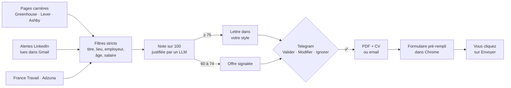

# Agent de recherche d'emploi ciblée

**L'inverse des outils qui postulent en masse.** Cet agent lit des milliers d'offres, n'en garde que
quelques-unes, écrit pour chacune une lettre dans votre style à partir de vos vrais faits, et vous
laisse tout valider sur Telegram. Il pré-remplit ensuite le formulaire de candidature, et c'est vous
qui cliquez sur « Envoyer ».

> *English summary: a job-search agent that does the opposite of mass-application tools. It monitors
> career pages and LinkedIn alerts, filters and scores offers with an LLM, drafts cover letters in the
> candidate's own voice from a base of verified facts, and asks for approval on Telegram before
> pre-filling application forms. The final submission always stays with the human.*

Sur 10 jours d'usage réel : **2 700 offres lues, 37 retenues** pour être notées, quelques-unes
proposées avec une lettre.



## Ce qu'il fait

- **Veille continue.**
  - Pages carrières d'entreprises via les API publiques Greenhouse, Lever et Ashby, toutes les
    15 minutes.
  - Alertes emploi LinkedIn reçues par email, lues dans Gmail en lecture seule. L'agent ne se
    connecte jamais à LinkedIn.
  - France Travail et Adzuna, facultatifs.
- **Tri en deux temps.**
  - D'abord des filtres gratuits sur le titre, le lieu, le type d'employeur, l'âge de l'offre et le
    salaire.
  - Ensuite, une note sur 100 donnée par un LLM, avec points forts et points faibles. Elle tient
    compte des offres que vous avez déjà écartées.
- **Lettres qui vous ressemblent.** Elles sont rédigées à partir de :
  - votre fiche de faits ;
  - un guide de style tiré de vos propres lettres ;
  - une lettre de référence.

  L'agent n'a pas le droit d'inventer un fait. Chaque lettre que vous validez devient un nouvel
  exemple de style.
- **Validation sur Telegram.**
  - ✅ Valider, ✏️ Modifier (par une consigne ou en collant votre version), ❌ Ignorer avec un motif.
  - Choix du CV joint (français, anglais ou aucun).
  - Commandes `/scan`, `/stats`, `/cv`, `/pause`.
- **Pré-remplissage des formulaires** Greenhouse, Lever et Ashby.
  - Identité, CV et lettre joints, réponses rédigées aux questions de l'offre.
  - Les réponses factuelles (salaire, préavis, visa) viennent d'un fichier que vous remplissez.
    L'agent ne les devine jamais.
  - Les cases de consentement ne sont jamais cochées à votre place.
- **Envoi par email** quand l'offre donne une adresse, seulement après votre ✅.

## Ce qu'il ne fait pas, volontairement

- **Il ne postule jamais à votre place.** Le clic final sur « Envoyer » reste le vôtre.
- **Il n'automatise pas LinkedIn.** Les conditions d'utilisation l'interdisent, et votre compte
  serait en jeu.
- **Il ne contourne aucun captcha.**

## Installation

Il vous faut Python 3.11 ou plus récent, Google Chrome et un bot Telegram. Pour Claude, vous avez le
choix entre Claude Code, avec un abonnement Claude, et une clé API Anthropic.

```bash
python3 -m venv .venv && .venv/bin/pip install -r requirements.txt
```

```bash
cp exemple/config.yaml config.yaml && cp -R exemple/profil profil && cp .env.example .env
```

1. **Votre profil, dans `profil/`.**
   - Remplissez `profil.md` : vos faits, avec des détails concrets.
   - Remplissez `style.md` : votre façon d'écrire.
   - Collez votre meilleure lettre dans `lettres/reference_TRANSPOP.txt`.
   - Remplissez `candidature.yaml` : vos réponses factuelles.
   - Déposez votre CV en PDF.
2. **Vos critères, dans `config.yaml`.** Identité, seuils, mots-clés, lieux, salaires minimums et
   entreprises suivies.
3. **Vos clés, dans `.env`.**
   - Jeton du bot Telegram, obtenu auprès de @BotFather.
   - Mot de passe d'application Gmail.
   - Clés France Travail et Adzuna, facultatives.
4. **Claude.**
   - Par défaut, l'agent passe par Claude Code (`ia.moteur: abonnement`). Connectez-vous une fois
     avec `claude`, puis `/login`.
   - Pour passer par l'API, mettez `moteur: api` et `ANTHROPIC_API_KEY`.
5. **Vérification et lancement.**

```bash
.venv/bin/python -m jobbot verifier
```

```bash
.venv/bin/python -m jobbot essai
```

```bash
.venv/bin/python -m jobbot
```

- `verifier` teste chaque clé.
- `essai` montre ce que l'agent trouverait, sans IA ni Telegram.
- La dernière commande lance l'agent.
- Envoyez `/start` à votre bot : il vous donne l'identifiant à mettre dans `TELEGRAM_CHAT_ID`.

**Démarrage automatique sur macOS :** voir `deploiement/com.jobbot.plist.exemple`.

## Tests

```bash
.venv/bin/python -m pytest -q
```

Les tests utilisent votre propre `config.yaml` et votre profil. Dans un dépôt fraîchement cloné, ils
sont ignorés tant que vous n'avez pas copié le dossier `exemple/`.

## Structure

| Fichier | Rôle |
|---|---|
| `jobbot/sources/` | Greenhouse, Lever, Ashby, alertes LinkedIn (IMAP), France Travail, Adzuna |
| `jobbot/filters.py` | Filtres stricts, avant tout appel à l'IA |
| `jobbot/llm.py` | Notation, lettres et réponses aux formulaires (sorties JSON structurées) |
| `jobbot/pipeline.py` | Collecte, tri, rédaction, validation et envoi |
| `jobbot/telegram_bot.py` | Interface Telegram |
| `jobbot/prefill.py` | Pré-remplissage des formulaires avec Playwright et Chrome |
| `jobbot/db.py` | Base SQLite : offres vues, notes, lettres, suivi |

## Auteur

Conçu par [Steven Crombecque](https://www.linkedin.com/in/steven-crombecque-054766184/), docteur en
sciences de la santé et data scientist. Développé avec [Claude Code](https://claude.com/claude-code).

Licence MIT.
